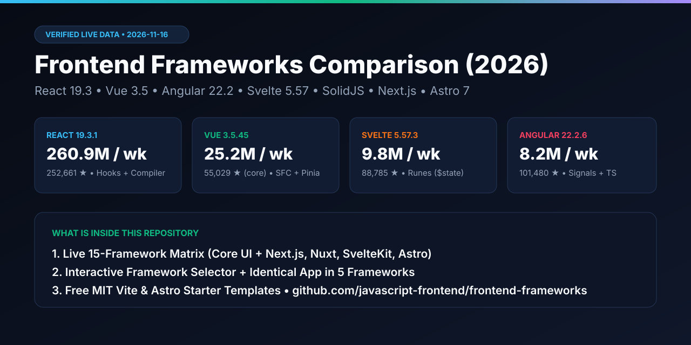

<div align="center">

# Frontend Frameworks Comparison, Selector & Starter Templates (2026)

Data-verified comparison of 15 active frontend frameworks and meta-frameworks: live GitHub and npm metrics, workload selector, the same app built in 5 frameworks, and free MIT starter templates.

[](https://github.com/javascript-frontend/frontend-frameworks/actions/workflows/ci.yml)
[](#-complete-frontend-frameworks-comparison-table-2026)
[](guides/methodology-and-data-sources.md)
[](#-same-app-across-5-frameworks-sprint-task-tracker)
[](LICENSE)

[Interactive Web Selector](https://javascript-frontend.github.io/frontend-frameworks/) | [Decision Matrix](#-quick-decision-matrix-which-frontend-framework-should-you-choose) | [2026 Comparison Table](#-complete-frontend-frameworks-comparison-table-2026) | [Same App in 5 Frameworks](#-same-app-across-5-frameworks-sprint-task-tracker) | [Free Starters](#-free-mit-starter-templates) | [CLI Advisor](#-quick-start-cli-framework-selector) | [FAQ](#-frequently-asked-questions-faq)

</div>

---

## Why This Repository Exists

Older **frontend frameworks** popularity gists from 2018-2023 rely on broken chart links, outdated major versions, and scattered metrics without architecture guidance.

**`javascript-frontend/frontend-frameworks`** keeps everything verified in one place (last checked `2026-11-16`):
1. **Verified Live Metrics (`frameworks.json`):** GitHub stars, forks, latest npm releases, and weekly npm downloads fetched directly from official GitHub and npm APIs.
2. **Workload Selection:** Match a **JavaScript frontend framework** to SaaS dashboards, SEO content sites, enterprise platforms, e-commerce, or zero-build HTML via the [interactive web selector](https://javascript-frontend.github.io/frontend-frameworks/), TypeScript CLI (`src/advisor.ts`), or Python CLI (`framework_advisor.py`).
3. **Identical App in 5 Frameworks:** Compare React 19, Vue 3.5, Svelte 5, Angular 22, and SolidJS implementations of the exact same Sprint Task Tracker.
4. **Free Starter Templates:** Copy minimal TypeScript Vite and Astro 7 starters with one command.



---

## Quick Decision Matrix: Which Frontend Framework Should You Choose?

| Your Project / Workload | Top Recommendation | Runner-Up | Why It Wins | Starter / Guide |
| :--- | :--- | :--- | :--- | :--- |
| Interactive SaaS Dashboard | React 19 / Next.js 16 | Vue 3.5 / Svelte 5 | Largest UI and AI component ecosystem and hiring pool | [`react-vite-ts-saas`](starters/react-vite-ts-saas/) |
| SEO Content, Docs & Landings | Astro 7 | Next.js 16 / SvelteKit 3 | Zero client JS by default with Islands architecture | [`astro-seo-landing`](starters/astro-seo-landing/) |
| Balanced Team App / Portal | Vue 3.5 / Nuxt 4 | Svelte 5 | Cohesive first-party router, Pinia state, gentle curve | [`vue3-vite-ts-app`](starters/vue3-vite-ts-app/) |
| Large Enterprise Platform | Angular 22 | React + TypeScript | Strict conventions, built-in DI, Signals, and forms | [Decision Guide](guides/how-to-choose-a-frontend-framework.md) |
| Minimal Bundle / High Perf | Svelte 5 / SolidJS | Preact 11 / Qwik | Compiled fine-grained DOM updates, tiny runtime | [`svelte5-vite-ts-app`](starters/svelte5-vite-ts-app/) |
| Server-HTML Enhancement | Alpine.js 3 / htmx | Preact 11 | Zero build step for Rails, Django, Laravel, Go | [SEO & AI Guide](guides/frontend-frameworks-for-seo-and-ai.md) |

---

## Complete Frontend Frameworks Comparison Table (2026)

*All versions, GitHub stars, and npm weekly downloads verified against live APIs on `2026-11-16` ([methodology](guides/methodology-and-data-sources.md)).*

### Core UI Frameworks & Libraries

| Framework | Latest | GitHub Stars | npm Weekly | Rendering & Reactivity | Runtime Tier | SSR/SEO |
| :--- | :--- | ---: | ---: | :--- | :--- | :---: |
| [React](https://react.dev/) (`facebook/react`) | `19.3.1` | 252,661 | 260.9M | Virtual DOM + Hooks + React Compiler | Medium (~45 KB) | 4/5 |
| [Angular](https://angular.dev/) (`angular/angular`) | `22.2.6` | 101,480 | 8.2M | Signals (Zoneless) + RxJS | Larger (~65+ KB) | 4/5 |
| [Svelte](https://svelte.dev/) (`sveltejs/svelte`) | `5.57.3` | 88,785 | 9.8M | Compiler + Runes (`$state`, `$derived`) | Tiny (~3-5 KB) | 5/5 |
| [Vue](https://vuejs.org/) (`vuejs/core`)* | `3.5.45` | 55,029 | 25.2M | VDOM + Proxy Composition API | Small-Medium (~22 KB) | 4/5 |
| [htmx](https://htmx.org/) (`bigskysoftware/htmx`) | `2.0.11` | 49,644 | 456.0K | Hypermedia HTML Attributes (`hx-*`) | Tiny (~14 KB, no build) | 5/5 |
| [Preact](https://preactjs.com/) (`preactjs/preact`) | `11.2.0` | 39,008 | 59.0M | Lightweight Virtual DOM + Signals | Tiny (~4 KB) | 4/5 |
| [SolidJS](https://www.solidjs.com/) (`solidjs/solid`) | `1.9.19` | 36,273 | 11.7M | No VDOM + Fine-Grained Signals | Tiny (~7 KB) | 4/5 |
| [Alpine.js](https://alpinejs.dev/) (`alpinejs/alpine`) | `3.17.5` | 32,021 | 931.1K | Direct HTML Directives (`x-data`) | Tiny (~15 KB, no build) | 5/5 |
| [Qwik](https://qwik.dev/) (`QwikDev/qwik`) | `1.20.4` | 22,072 | 61.3K | Resumability (Zero-Hydration) | Tiny (~1 KB bootstrap) | 5/5 |
| [Lit](https://lit.dev/) (`lit/lit`) | `3.3.3` | 21,896 | 9.8M | Native Web Components + Templates | Tiny (~5 KB) | 3/5 |

> \* **Vue Note:** `vuejs/core` (`55,029` stars) is the active Vue 3 codebase; the legacy Vue 2 repository `vuejs/vue` holds `212,519` stars. `htmx.org` npm latest is `2.0.11` (GitHub release tag: `v4.0.1`).

### Full-Stack Meta-Frameworks (SSR, Routing & SEO)

| Meta-Framework | Latest | GitHub Stars | npm Weekly | Core Engine | Primary Strength | SSR/SEO |
| :--- | :--- | ---: | ---: | :--- | :--- | :---: |
| [Next.js](https://nextjs.org/) (`vercel/next.js`) | `16.4.6` | 143,582 | 94.4M | React 19 + App Router + RSC | Default full-stack React SSR/SSG | 5/5 |
| [Astro](https://astro.build/) (`withastro/astro`) | `7.4.12` | 63,986 | 12.0M | Islands Architecture (0 JS default) | Content, docs, marketing & SEO sites | 5/5 |
| [Nuxt](https://nuxt.com/) (`nuxt/nuxt`) | `4.6.4` | 61,078 | 3.4M | Vue 3.5 + Nitro Engine | Cohesive hybrid SSR/SSG for Vue | 5/5 |
| [React Router](https://reactrouter.com/) (`remix-run/react-router`) | `8.5.1` | 56,637 | 76.9M | React 19 + Loaders/Actions | Web-standard nested routes & SSR | 5/5 |
| [SvelteKit](https://svelte.dev/docs/kit) (`sveltejs/kit`) | `3.2.0` | 20,914 | 5.3M | Svelte 5 + Vite + Adapters | Lean full-stack SSR with tiny bundles | 5/5 |

---

## Same App Across 5 Frameworks (Sprint Task Tracker)

To compare syntax and mental models directly, [`examples/same-app-task-tracker/`](examples/same-app-task-tracker/) implements the same Sprint Task Tracker (add task + priority, `all/active/done` filter, derived remaining counter, toggle/delete, and `localStorage` persistence) in five frameworks:

| Implementation | Source File | Lines | State & Derived Primitives |
| :--- | :--- | ---: | :--- |
| Vue 3.5 | [`examples/same-app-task-tracker/vue/App.vue`](examples/same-app-task-tracker/vue/App.vue) | 76 | `ref()`, `computed()`, `watch()` |
| Svelte 5 | [`examples/same-app-task-tracker/svelte/App.svelte`](examples/same-app-task-tracker/svelte/App.svelte) | 77 | `$state()`, `$derived()`, `$effect()` |
| React 19 | [`examples/same-app-task-tracker/react/App.tsx`](examples/same-app-task-tracker/react/App.tsx) | 82 | `useState()`, `useMemo()`, `useEffect()` |
| SolidJS 1.9 | [`examples/same-app-task-tracker/solid/App.tsx`](examples/same-app-task-tracker/solid/App.tsx) | 88 | `createSignal()`, `createMemo()`, `createEffect()` |
| Angular 22 | [`examples/same-app-task-tracker/angular/app.component.ts`](examples/same-app-task-tracker/angular/app.component.ts) | 93 | `signal()`, `computed()`, `effect()` |

Inspect the interactive side-by-side viewer on [GitHub Pages](https://javascript-frontend.github.io/frontend-frameworks/#same-app) or read the [code breakdown](examples/same-app-task-tracker/README.md).

---

## Free MIT Starter Templates

Copy any minimal starter template under [`starters/`](starters/) in one command:

```bash
# React 19 + Vite + TypeScript SaaS baseline
npx degit javascript-frontend/frontend-frameworks/starters/react-vite-ts-saas my-saas-app

# Vue 3.5 + Vite + TypeScript baseline
npx degit javascript-frontend/frontend-frameworks/starters/vue3-vite-ts-app my-vue-app

# Svelte 5 Runes + Vite + TypeScript baseline
npx degit javascript-frontend/frontend-frameworks/starters/svelte5-vite-ts-app my-svelte-app

# Astro 7 Zero-JS SEO Landing baseline
npx degit javascript-frontend/frontend-frameworks/starters/astro-seo-landing my-seo-site
```

---

## Quick Start: CLI Framework Selector

Run either the TypeScript CLI (`src/advisor.ts`, Node 22+) or the Python CLI (`framework_advisor.py`, Python 3.9+) with zero third-party dependencies:

```bash
git clone https://github.com/javascript-frontend/frontend-frameworks.git
cd frontend-frameworks

# TypeScript CLI (Node 22+)
node src/advisor.ts --use-case saas-dashboard --seo-critical
node src/advisor.ts --compare react vue svelte angular solid

# Python CLI (Python 3.9+)
python3 framework_advisor.py --use-case saas-dashboard --seo-critical
python3 framework_advisor.py --export-csv > frontend-frameworks-2026.csv
```

---

## Deep-Dive Guides

* [How to Choose a Frontend Framework in 2026](guides/how-to-choose-a-frontend-framework.md)
* [React vs Vue vs Angular vs Svelte (2026 Comparison)](guides/react-vs-vue-vs-angular-vs-svelte.md)
* [Best Frontend Frameworks for SEO & AI Overviews](guides/frontend-frameworks-for-seo-and-ai.md)
* [Methodology & Live API Verification](guides/methodology-and-data-sources.md)

---

## Frequently Asked Questions (FAQ)

### What is the most popular frontend framework in 2026?
React (`19.3.1`) leads in ecosystem adoption with 252,661 GitHub stars and 260.9M weekly npm downloads, followed on npm by Next.js (94.4M/week), React Router (76.9M/week), Preact (59.0M/week), and Vue (25.2M/week).

### Which frontend framework is best for SEO and Core Web Vitals?
For content-heavy websites, documentation, blogs, and marketing landings, Astro (`7.4.12`) is the strongest default because it ships 0 KB of client JavaScript unless an interactive island opts in. For dynamic web applications needing per-request SSR, use Next.js, Nuxt, or SvelteKit.

### Should beginners choose React, Vue, or Svelte in 2026?
If your priority is job market demand, start with React 19 + TypeScript. If your priority is fast onboarding and minimal boilerplate, Vue 3.5 and Svelte 5 offer simpler single-file components and fewer re-render footguns.

### Why do some older lists show Vue with over 200,000 stars while others show 55,000?
Vue 2 lived in `vuejs/vue` (`212,519` stars, now legacy), while active Vue 3 development moved to `vuejs/core` (`55,029` stars). Combining or confusing those repositories is a common error in older comparison posts.

### How can I check which framework fits my project right now?
Use the [Interactive Frontend Framework Selector](https://javascript-frontend.github.io/frontend-frameworks/) or run `node src/advisor.ts --use-case <workload>`.

---

## Contributing & Support

Contributions, version updates, and new `examples/` or `starters/` PRs are welcome. See [`CONTRIBUTING.md`](CONTRIBUTING.md) or open an [Issue](https://github.com/javascript-frontend/frontend-frameworks/issues).

If this comparison saved you research time, consider starring the repository so more developers find current data instead of abandoned gists.

## License

Distributed under the MIT License. See [`LICENSE`](LICENSE).
